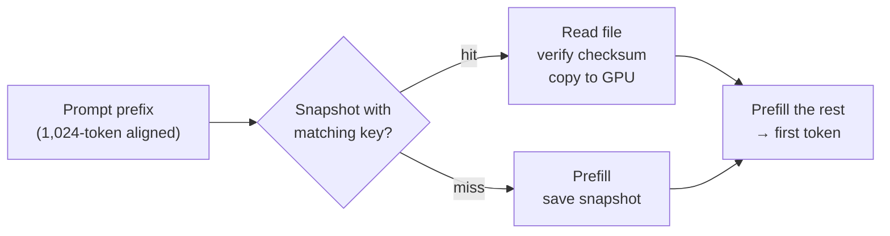

# Persistent prefill state for uzu

Prototype for [#792](https://github.com/trymirai/uzu/issues/792): prefill a long prompt prefix once, save the state to
disk, restore it in any new session.

**8K-token prefix: 3.66 s → 82 ms to first token.** Byte-identical output at 1,024-token boundaries. M1 Pro, Qwen 3.5 0.8B.

## How it works

- **Stores the full state:** attention KV, DeltaNet and ShortConv state. Qwen 3.5 is hybrid, so KV alone isn't enough.
- **Key:** model hash, device, kernel build, numerics mode, exact tokens. Any mismatch → normal prefill.
- **Chat API:** `ChatMessage::with_kv_cache_breakpoint()` + `ChatConfig::with_kv_cache_directory()`.

## Results

Time to first token, cold restore from SSD, median of 15 runs.

| Prefix | Qwen 3.5 0.8B | LFM2.5 230M |
|---:|---:|---:|
| 1,024 | 415 → 64 ms (6.5x) | 129 → 22 ms (6.0x) |
| 2,048 | 821 → 57 ms (14.3x) | 250 → 20 ms (12.6x) |
| 4,096 | 1,801 → 68 ms (26.6x) | 520 → 41 ms (12.7x) |
| 8,192 | 3,665 → 82 ms (45.0x) | 1,155 → 52 ms (22.3x) |

- **Exact:** state hash, 100/100 logits and all continuations identical to an uncached run, both models.
- **Safe:** 10/10 bad or mismatched files miss and fall back.
- **Fast as the disk:** restore is 10–21 ms, read at ~6 GB/s.
- **Chat:** 4,400-token system prompt, 2.2 s → 0.19 s, same output.
- **Catch:** only the 1,024-aligned part is cached. A 1,499-token prompt gets 2.7x; under 1,024 tokens, nothing.

Opt-in batch-invariant mode: exact restores at any 64-token boundary (1,499 tokens: 2.7x → 8.6x); no measurable quality
change vs a CPU reference on 48 probes, though it narrowly misses our pre-set 20% non-inferiority margin. Off by default.

## More

- [Full write-up](PREFIX_CACHE_DETAILS.md): format, hit rules, stage timings, MLX / llama.cpp comparison, eval method
- [Raw records](prefix-cache-results)
- Limits: one machine (no MXU), two small models, bindings not regenerated, no eviction yet

## Questions for maintainers

1. Engine PR first, chat API after?
2. Breakpoint as a `ChatMessage` flag (built) or a `ChatContentBlock`?
3. Cache settings in `ChatConfig`, `EngineConfig`, or the server?
